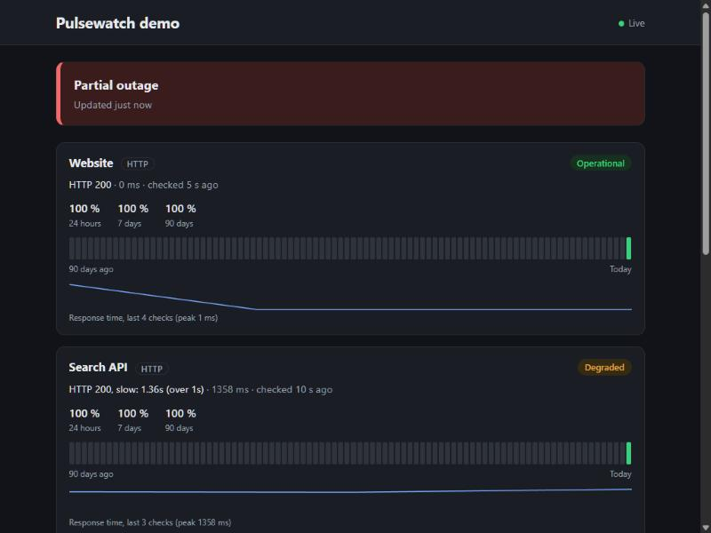

# Pulsewatch

An uptime monitor and status page in Go. It checks websites, TLS certificates and DNS names on
a schedule, keeps 90 days of history, opens an incident when something stays down, sends an
alert to Discord, Slack or any webhook, and serves a public status page that updates itself
live. One binary, one YAML file, Prometheus metrics included.

**Live status page: https://gallileee.github.io/pulsewatch/**. It watches my other projects,
runs on GitHub Actions every 5 minutes and costs nothing ([how](#free-hosting-on-github-actions-and-pages)).



```
$ pulsewatch -demo                      # a local demo service with outages, page on :8090
$ pulsewatch -config pulsewatch.yaml    # your own targets
$ pulsewatch -once -site site           # check once, write a static page (cron, CI)
$ docker compose up --build             # Pulsewatch + Prometheus
```

## Why

Every project I put online should say whether it's up, and I'd like to know before someone
tells me. Hosted monitors do this, but a monitor is also a good systems exercise. It needs
concurrent work on a schedule, timeouts everywhere and state that survives restarts. It has to
tell a hiccup from an outage, retry flaky notifications, and push live updates to browsers. It
watches my other projects, [Market Pulse](https://gallileee.github.io/market-pulse/) among them.

## What it does

- **Checks**
  - **HTTP(S):** GET a URL. A status code outside 200–399 means down; `expect_status` sets
    your own list. `expect_body` text must be in the answer. Answers slower than
    `degraded_after` count as degraded.
  - **TLS:** make a handshake and verify the certificate. A certificate that doesn't verify
    (expired, wrong name, unknown issuer) means down. One that expires within `warn_days`
    (14 by default) is degraded.
  - **DNS:** resolve a name, optionally to one of `expect_addresses`.
- **Schedule:** each target runs at its own interval (at least 5 s), with a timeout. The
  targets start spread over their interval, and at most `max_concurrent` checks run at once.
- **Incidents:** an incident opens after `failures_to_open` failed checks in a row (2 by
  default). It counts from the first failed check, so a single blip opens nothing. It's
  resolved after `successes_to_resolve` good checks. Degraded counts as good, so slow isn't an
  outage. An incident that was open at a restart continues and closes when the target recovers.
- **Alerts** go out when an incident opens or is resolved:
  - **Formats:** a Discord or Slack message, or the whole incident as JSON to any webhook.
  - **Retries:** network errors, 429 and 5xx are retried after 1 s, 2 s and 4 s. A 4xx isn't
    retried.
  - **Never blocking:** sending happens in the background, so a slow webhook never delays a
    check.
  - **Secrets:** webhook URLs come from `${ENVIRONMENT_VARIABLES}`. Errors and logs never show
    them.
- **History:** the last 60 checks and hourly totals for 90 days, per target. It's saved to a
  JSON file every minute and on shutdown, written to a temporary file and renamed so a crash
  can't corrupt it. A file that can't be read is moved aside, not overwritten.
- **Status page:**
  - **Contents:** an overall banner, then per target its status, last message, uptime for
    24 hours, 7 days and 90 days, 90 daily bars (each with a tooltip) and a response-time line.
    The incident history is listed below.
  - **Live updates:** the page listens to **server-sent events**. After each check it fetches
    the re-rendered part once a second at most. Without JavaScript it still works, as a plain
    page.
  - **Look:** light and dark themes, phone to desktop, and a strict Content-Security-Policy
    (no inline scripts or styles).
- **API and metrics:**
  - `/api/status` gives the page as JSON (CORS open: it's public).
  - `/metrics` is Prometheus text format: `pulsewatch_up`, `pulsewatch_degraded`,
    `pulsewatch_checks_total`, a `pulsewatch_check_duration_seconds` histogram,
    `pulsewatch_incident_open` and `pulsewatch_tls_cert_expiry_timestamp_seconds`.
  - `/healthz` answers `ok`.
  - `/badge/<id>.json` is a target's status and 7-day uptime for a
    [Shields.io endpoint badge](https://shields.io/badges/endpoint-badge). A README can show
    it, for example :

    ```markdown
    
    ```

    The static site (`-site`) writes the same files under `badge/`.

## Configuration

```yaml
title: Gallileee status
listen: ":8080"
data_file: pulsewatch-data.json   # leave out to keep the history in memory only
public_url: https://status.example.com   # linked from alerts
incidents:
  failures_to_open: 2
  successes_to_resolve: 2
alerts:
  - name: team chat
    format: discord          # webhook, discord or slack
    url: ${DISCORD_WEBHOOK_URL}
targets:
  - name: Market Pulse
    url: https://gallileee.github.io/market-pulse/
    interval: 1m             # default 1m
    timeout: 10s             # default: 10s, or half the interval if that's shorter
    expect_body: Market Pulse
    degraded_after: 2s
  - name: Certificate
    type: tls
    host: gallileee.github.io   # host or host:port (443 by default)
    interval: 1h
    warn_days: 14
  - name: DNS
    type: dns
    host: github.com
    # expect_addresses: [192.0.2.10]   # optional: must resolve to one of these
```

[examples/pulsewatch.yaml](examples/pulsewatch.yaml) is a complete file. The config is
checked when Pulsewatch starts, and all its problems are listed at once: an unknown key, a bad
duration, a duplicate name, a URL that isn't http(s), a timeout as long as the interval, and
so on.

## Running it

From source, with Go 1.25 or newer:

```bash
go run ./cmd/pulsewatch -demo                       # http://127.0.0.1:8090
go run ./cmd/pulsewatch -config examples/pulsewatch.yaml
go build -o pulsewatch ./cmd/pulsewatch             # one static binary
```

With Docker, `docker compose up --build` starts Pulsewatch on :8080 with the example config,
and Prometheus on :9090 scraping it. The image is distroless and runs as a non-root user; the
history lives in a volume. For alerts, put `DISCORD_WEBHOOK_URL=...` in a `.env` file next to
`docker-compose.yml` (it's git-ignored) and uncomment the alert in the config.

### Free hosting on GitHub Actions and Pages

Pulsewatch doesn't have to run all the time. `pulsewatch -once` checks every target once,
saves the history and exits, and `-site DIR` also writes the status page as static files
(`index.html`, `status.json`, `static/`). The incident streaks are saved with the history, so
two runs in a row that fail open an incident like two checks in a row do. Nothing about the
history changes between modes, so a `pulsewatch-data.json` from a server works here too.

[.github/workflows/status.yml](.github/workflows/status.yml) runs it every 5 minutes with
[deploy/status.yaml](deploy/status.yaml):

1. It builds Pulsewatch.
2. It downloads the history that the last run uploaded as an artifact.
3. It checks the targets.
4. It uploads the new history.
5. It publishes `site/` to GitHub Pages.

On a public repository this costs nothing. The trade-offs:
- The static page has no live stream: it reloads its content once a minute.
- There's no `/metrics`.
- Scheduled runs are often a few minutes late.
- GitHub pauses scheduled workflows after 60 days without activity in the repository.
- The history artifacts are kept for 3 days, so the history survives an outage of the
  workflow shorter than that.

To use it in a fork:
1. Set **Settings → Pages → Source** to "GitHub Actions".
2. Change `deploy/status.yaml`.
3. For alerts, add the webhook as a repository secret and pass it to the run step in `env:`.

### The demo

The **demo** (`-demo`) runs a small local service that misbehaves on purpose:
- one endpoint is always fine;
- one is slow, so it's degraded;
- one fails a quarter of the time, which is not enough for an incident;
- one has an outage every 6 minutes, so incidents open, alerts would go out and they resolve.

## How it's built

| Package | Role |
| --- | --- |
| `internal/config` | YAML (strict: unknown keys are errors), defaults, `${ENV}` in values, validation. |
| `internal/check` | The HTTP, TLS and DNS checks; a result is up, degraded or down, with a message. |
| `internal/incident` | A small state machine per target: failure and success streaks, incidents. |
| `internal/store` | Recent checks and hourly totals; uptime and daily bars; atomic JSON save. |
| `internal/monitor` | One goroutine per target, a semaphore for concurrency, and the event broker for live updates. |
| `internal/notify` | Webhook, Discord and Slack formats, retries with backoff, sending in the background. |
| `internal/metrics` | Prometheus text format written by hand: a handful of series need no client library. |
| `internal/web` | Status page (`html/template`, embedded files), JSON, SSE, metrics, security headers. |
| `internal/clock` | Real and fake clocks, so tests move time instead of sleeping. |
| `internal/demo` | The misbehaving demo service. |

Some decisions:

- **Time goes through an interface.** The scheduler and the TLS check read a `clock.Clock`.
  In tests, a fake clock is moved forward by hand: the scheduler test checks the intervals and
  start offsets without sleeping. The TLS test sets the clock to 5 days before the test
  certificate expires, then past it, because verification uses the same clock.
- **One goroutine per target, one semaphore for all.** Simple to follow. A slow target only
  delays itself, and `max_concurrent` caps the sockets open at once.
- **Server-sent events, not WebSockets.** The page only listens. SSE works over plain HTTP,
  reconnects by itself and needs no library. The events are small ("target X was checked").
  The page then fetches the HTML the server renders, so there is one renderer, the Go
  template. A browser that falls behind loses events instead of slowing the checks.
- **Hourly totals, not every check.** 90 days of one-minute checks is about 130,000 results
  per target. Hourly totals are 2,160 rows and still give uptime and daily bars. The last 60
  checks are kept one by one for the response-time line.
- **Only one dependency,** `gopkg.in/yaml.v3`. Everything else is the standard library.

## Development

```bash
go test ./...          # all tests (add -race on Linux or with cgo)
go vet ./...
gofmt -l .             # lists files that need formatting
```

CI runs those on Linux (with `-race`) and Windows. It also builds the Docker image and runs a
smoke test of the demo inside it. The workflow itself is checked by
[workflow-guard](https://github.com/Gallileee/workflow-guard).

## Limits

- One instance: there is no clustering, so the monitor can't watch itself. Run a second one
  somewhere else, or use an outside check on `/healthz`. On GitHub Actions, a failed run
  shows on the Actions tab, and the page's "Updated" time stops moving.
- Uptime counts whole hours, so "24 hours" may include up to one more hour. Days are in UTC.
- No email alerts yet, no authentication for private pages, no maintenance windows (see
  [PROGRESS.md](PROGRESS.md)).

## License

MIT, see [LICENSE](LICENSE).
